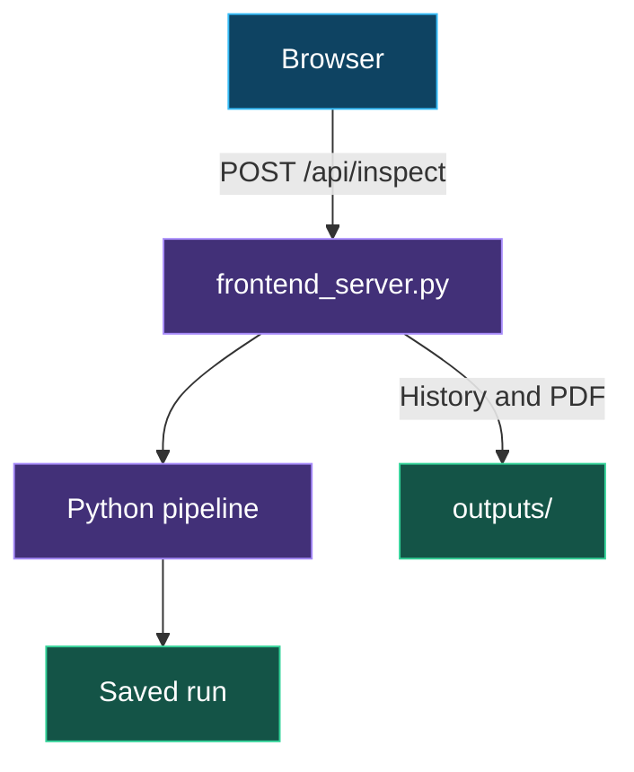
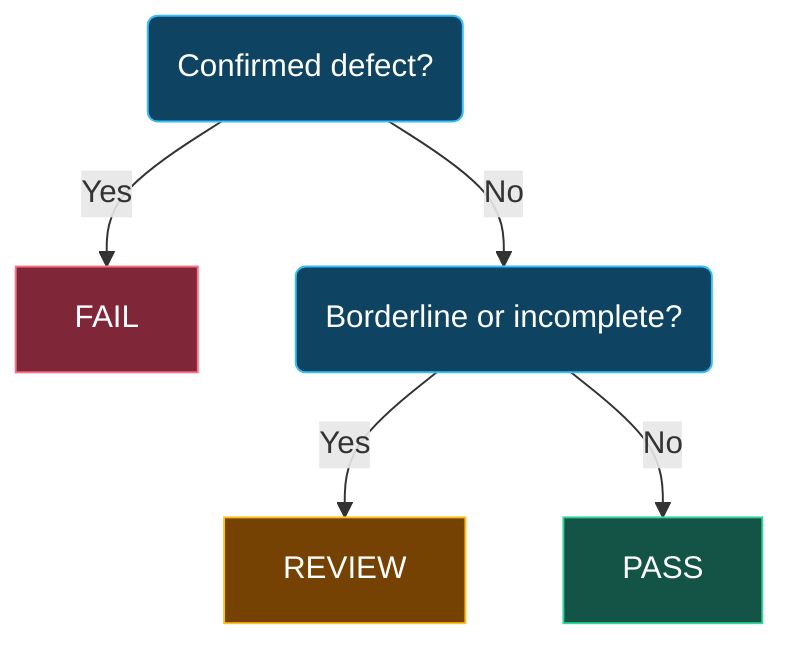

# Circuit-Check-AI


Circuit-Check-AI uses YOLO to locate visible defects in photos of bare printed circuit boards (PCBs). Compare the original and annotated board, zoom to individual findings, and download a PDF inspection report. Completed live runs are saved locally and can be reopened from History.

[Quick start](#quick-start-on-windows) · [Interface](#interface) · [Inspection flow](#inspection-flow) · [Verdict rules](#verdict-rules)

## Interface

Screenshots from the running HTML, CSS, and JavaScript frontend. Inspect and History show a held-out test photo processed locally with a PCB-trained model.

### Inspect

[](docs/media/inspect.png)

Open a saved inspection or preview a JPG, JPEG, or PNG upload. Select a numbered finding or use **Previous** and **Next** to zoom to its location. **Fit board** restores the full view. Synced zoom moves both views together when the matching original is available.

| About | History |
| --- | --- |
| [](docs/media/about.png) | [](docs/media/history.png) |
| See the inspection workflow and supported defect types. | Search by filename, filter by verdict, reopen the exact selected run, or download its PDF. |

## Quick start on Windows

With Git and Python installed, run these commands in PowerShell. For an existing checkout, start with `Set-Location` and use the path to your copy.

```powershell
git clone --depth 1 https://github.com/AhmadElkady/Circuit-Check-AI.git
Set-Location Circuit-Check-AI
python -m venv .venv
.\.venv\Scripts\python.exe -m pip install -r requirements-data.txt
.\.venv\Scripts\python.exe -m uvicorn frontend_server:app --host 127.0.0.1 --port 8770
```

Open [Circuit-Check-AI at 127.0.0.1:8770](http://127.0.0.1:8770/) and keep the terminal running. If you use a non-cone sparse checkout, include the application files and saved outputs before starting the server.

```powershell
git sparse-checkout add /frontend_server.py /frontend/ /src/ /outputs/ /requirements-data.txt
```

### Saved samples

**Open sample inspection**, **History**, and **Download report** work without model weights when the local web app is running. The repository includes five [saved reports](outputs/reports/) with matching [annotated images](outputs/annotated/). The default archived [FAIL sample](outputs/reports/board_A_20261125_220215_796447.json) has two confirmed spurious copper defects and one spur candidate for review. Inspect keeps the **Original PCB** panel visible with an unavailable message for these archives. Their PDFs label the missing original.

### Live uploads

Place a PCB-trained checkpoint at `models/yolo/weights/best.pt`. Obtain it from the team or train it using the steps below. Git ignores checkpoint files, so each checkout needs its own copy for live inference.

On **Inspect**, choose a JPG, JPEG, or PNG up to 20 MiB and click **Run inspection**. Each successful run saves `original.png`, `annotated.png`, and `report.json` together under `outputs/inspections/<inspection-id>/`. History lists these runs alongside the bundled archives. The local run directory is Git-ignored.

**Download report** on either page generates a PDF for the selected record from its saved JSON and images. The PDF includes the verdict, counts, and a numbered findings table with severity, confidence, and confirmed or review status. The JSON remains available to the app. To repeat the live example shown above, upload the [held-out PCB photo](datasets/pcb/images/test/missing_hole__04_missing_hole_01.jpg) with the trained checkpoint in place.

To feature a complete local run, put its ID in `outputs/inspections/featured.json` as `{"id":"<inspection-id>"}`. The default archived sample remains available in History.

## Inspection flow


The model looks for **missing holes, mouse bites, open circuits, shorts, spurs, and spurious copper**. Its training scope is visible defects on bare boards.

## Architecture



The server serves the frontend and reads both archived and live records from `outputs/`. For live uploads, it reuses the existing inference, box filtering, decision, and reporting modules.

## Verdict rules



A confirmed defect takes priority. With no confirmed defect, the decision function returns REVIEW for a borderline finding or an incomplete inspection. Otherwise it returns PASS. API errors can stop an inspection before it produces a verdict.

## Repository guide

| Path | Purpose |
| --- | --- |
| [frontend/](frontend/) | Inspect, About, and History in HTML, CSS, and JavaScript |
| [frontend_server.py](frontend_server.py) | Local web server, upload API, History catalog, and PDF download |
| [src/](src/) | Inference, post-processing, verdicts, reporting, and training |
| [src/pdf_report.py](src/pdf_report.py) | Shared PDF layout for Inspect and History |
| [outputs/](outputs/) | Bundled sample reports and annotations, training artifacts, and local inspection records |
| [main.py](main.py) | Legacy Streamlit demo with its own `streamlit` dependency |
| [scripts/](scripts/) and [datasets/pcb/](datasets/pcb/) | Dataset preparation and the grouped YOLO split |
| [tests/](tests/) | Run with `.\.venv\Scripts\python.exe -m pytest -q`. Model weights are optional for these tests. |

## Train and evaluate

The [PCB Defects dataset](https://www.kaggle.com/datasets/akhatova/pcb-defects) is converted from Pascal VOC annotations to YOLO labels and split by board group. The prepared split contains 393 training, 180 validation, and 120 test images. In a sparse checkout, include `/datasets/pcb/` before training. Set the `path` in [data.yaml](datasets/pcb/data.yaml) to your local dataset root, then run [the training script](src/train.py) from the repository root.

```powershell
.\.venv\Scripts\python.exe src/train.py
```

The script fine-tunes YOLOv8n and copies its validation-selected checkpoint to `models/yolo/weights/best.pt`. The checkpoint used for the screenshots scored 62.7% mAP50 and 27.1% mAP50–95 on the 120 held-out images. The test split covers one board design and contains labeled defects, so it cannot estimate the false-fail rate on clean boards.
