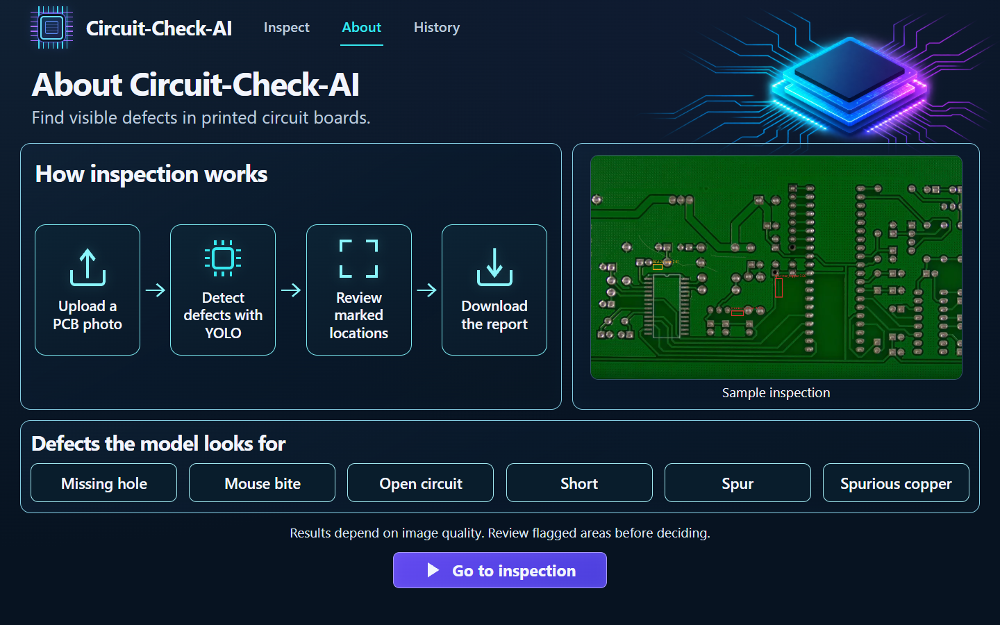
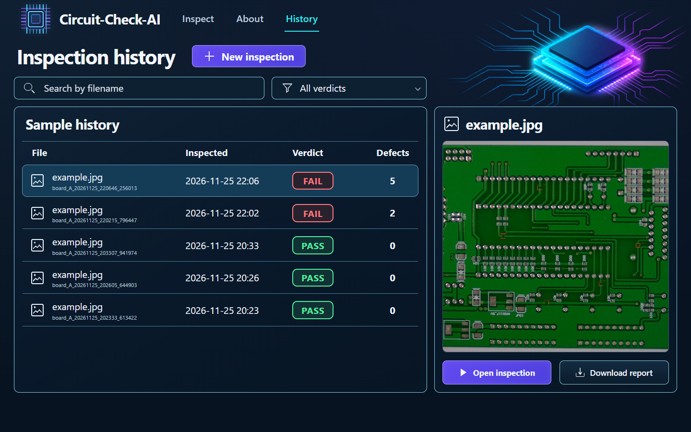
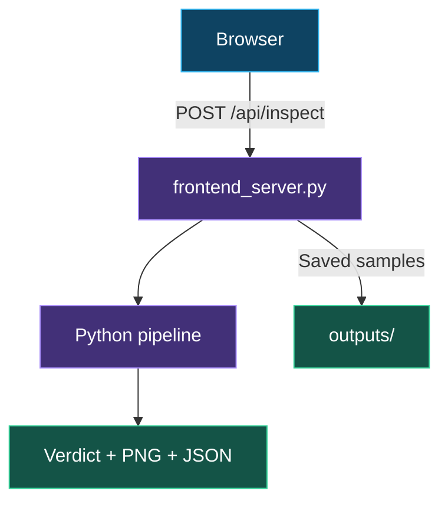
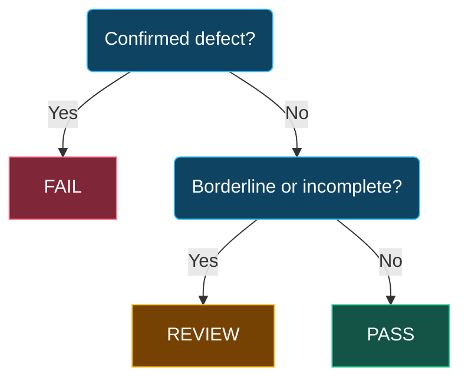

# Circuit-Check-AI


Circuit-Check-AI uses YOLO to locate visible defects in photos of bare printed circuit boards (PCBs). The browser interface lets you compare an uploaded board with its annotated result, review individual findings, and download a JSON report.

[Quick start](#quick-start-on-windows) · [Interface](#interface) · [Inspection flow](#inspection-flow) · [Verdict rules](#verdict-rules)

## Interface

Screenshots from the running HTML, CSS, and JavaScript frontend.

### Inspect

[](docs/media/inspect.png)

Open a saved inspection or preview a JPG, JPEG, or PNG upload. Use **Fit board**, the findings list, and **Previous** or **Next** to review positions on the annotated image. Synced zoom is available when the matching original is present.

| About | History |
| --- | --- |
| [](docs/media/about.png) | [](docs/media/history.png) |
| See the inspection workflow and supported defect types. | Search by filename, filter by verdict, open a saved result, or download its report. |

## Quick start on Windows

From the repository root in PowerShell, create a virtual environment and start the browser app.

```powershell
python -m venv .venv
.\.venv\Scripts\python.exe -m pip install -r requirements-data.txt fastapi uvicorn python-multipart
.\.venv\Scripts\python.exe -m uvicorn frontend_server:app --host 127.0.0.1 --port 8770
```

Open [Circuit-Check-AI at 127.0.0.1:8770](http://127.0.0.1:8770/) and keep the terminal running. If you use a non-cone sparse checkout, include the application files and saved outputs before starting the server.

```powershell
git sparse-checkout add /frontend_server.py /frontend/ /src/ /outputs/ /requirements-data.txt
```

### Saved samples

**Open sample inspection** and **History** work without model weights. The repository includes five [saved reports](outputs/reports/) and their [annotated images](outputs/annotated/). The featured [FAIL report](outputs/reports/board_A_20261125_220215_796447.json) has two confirmed spurious copper defects and one spur candidate for review. The archived originals are unavailable.

### Live uploads

Live inference requires the team's PCB-trained checkpoint at `models/yolo/weights/best.pt`. The checkpoint is distributed separately. The endpoint accepts one JPG, JPEG, or PNG image up to 20 MiB and produces a JSON report and an annotated PNG when the run completes.

**Live reporting is blocked on main at `7b4c0bb`.** The API calls `generate_report(output_dir=...)`, but the merged report generator does not accept that argument. A live upload can reach the API, but it cannot finish reporting until the caller and report generator agree. A missing checkpoint returns HTTP 503 before inference.

The browser presents successful live results on Inspect. **History lists the committed samples**. The API uses per-request temporary files, so new live runs are not added to History.

## Inspection flow


The model looks for **missing holes, mouse bites, open circuits, shorts, spurs, and spurious copper**. Its training scope is visible defects on bare boards.

## Architecture



The server also serves the frontend and the archived output files. For live uploads, it reuses the existing inference, box filtering, decision, and reporting modules.

## Verdict rules



A confirmed defect takes priority. With no confirmed defect, the decision function returns REVIEW for a borderline finding or an incomplete inspection. Otherwise it returns PASS. API errors can stop an inspection before it produces a verdict.

## Repository guide

| Path | Purpose |
| --- | --- |
| [frontend/](frontend/) | Inspect, About, and History in HTML, CSS, and JavaScript |
| [frontend_server.py](frontend_server.py) | Local web server and upload API |
| [src/](src/) | Inference, post-processing, verdicts, reporting, and training |
| [outputs/](outputs/) | Saved sample reports, annotations, and training artifacts |
| [main.py](main.py) | Legacy Streamlit demo with its own `streamlit` dependency |
| [scripts/](scripts/) and [datasets/pcb/](datasets/pcb/) | Dataset preparation and the grouped YOLO split |
| [tests/](tests/) | Run with `.\.venv\Scripts\python.exe -m pytest -q`. Model weights are optional for these tests. |

For training, the [PCB Defects dataset](https://www.kaggle.com/datasets/akhatova/pcb-defects) is converted from Pascal VOC annotations to YOLO labels and split by board group. Update the dataset root in [data.yaml](datasets/pcb/data.yaml) to match your checkout before running [the training script](src/train.py).
