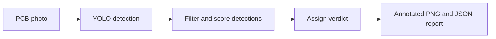

# Circuit-Check-AI

**Upload a PCB photo. See where the model found a defect. Export the inspection report.**

Circuit-Check-AI is a university Artificial Intelligence project that uses YOLO to locate visible defects in photos of bare printed circuit boards (PCBs). Each completed inspection produces a board verdict, a PNG with marked defect locations, and a JSON report with the findings.

[Quick start](#quick-start) · [Sample results](outputs/reports/) · [Frontend roadmap](#frontend-roadmap)

## How an inspection works



The model looks for **missing holes, mouse bites, open circuits, shorts, spurs, and spurious copper**. Its training scope is bare-board defects. Inspection of missing or misplaced components on assembled boards is outside that scope.

| Verdict | Meaning |
| --- | --- |
| **PASS** | The inspection completed without a confirmed defect or borderline candidate. |
| **FAIL** | At least one detection met its class's confirmation threshold. |
| **REVIEW** | There were no confirmed defects, but the decision logic found a borderline candidate or received an incomplete inspection. |

A PASS describes the model's findings on the submitted image. It does not certify that a board is defect-free. Errors such as missing model weights can stop the run before a verdict is produced.

## See a sample result

Browse the [saved JSON reports](outputs/reports/) and [annotated PCB images](outputs/annotated/). Match the files by their timestamped filename stem. The report records the verdict and includes each finding's class, confidence, severity, and bounding box in image pixels.

In one saved FAIL example, the model reported **two confirmed spurious copper defects** and **one spur candidate for review**. Keeping those counts separate makes it clear which findings drove the verdict.

## Quick start

Run these commands in PowerShell. You'll need Git and Python. The checkout includes a prepared dataset and is roughly 1 GB.

```powershell
git clone --depth 1 --branch main https://github.com/AhmadElkady/Circuit-Check-AI.git
cd Circuit-Check-AI
python -m venv .venv
.\.venv\Scripts\python.exe -m pip install -r requirements-data.txt streamlit
.\.venv\Scripts\python.exe -m pytest -q
```

The tests can run without model weights. To inspect an image, get the team's trained `best.pt` and place it at `models/yolo/weights/best.pt`. The checkpoint is distributed separately from the repository.

From the repository root, start the current demo:

```powershell
.\.venv\Scripts\python.exe -m streamlit run main.py
```

Open the local address shown in PowerShell, upload a `.jpg`, `.jpeg`, or `.png`, then click **Run Pipeline**.

## Frontend roadmap

The current repository includes a **Streamlit demo**. The planned HTML, CSS, and JavaScript interface has three screens:

| Screen | Planned experience |
| --- | --- |
| **Inspect** | Compare the original and annotated board with synced zoom. Select a numbered finding to jump to its location, including separate findings of the same type. |
| **About** | See how the model inspects a board and which defects it looks for. |
| **History** | Search saved inspections by filename, filter by verdict, reopen a result, or download its report. |

Saved JSON and PNG files can power a frontend prototype today. Live browser uploads need an HTTP inspection endpoint that returns the report and annotated image for the submitted photo. A live History screen also needs persistent storage for inspection results.

## Repository guide

| Location | Purpose |
| --- | --- |
| [main.py](main.py) | Current Streamlit demo |
| [src/pipeline.py](src/pipeline.py) | Runs the inspection from image input to report |
| [src/](src/) | Model inference, box filtering, verdict rules, reporting, and training |
| [scripts/](scripts/) | Dataset preparation and YOLO label generation |
| [datasets/pcb/](datasets/pcb/) | Prepared training, validation, and test data |
| [outputs/](outputs/) | Example reports, annotated images, and training artifacts |
| [tests/](tests/) | Automated checks for the inspection logic |

## Dataset

The project uses the [PCB Defects dataset on Kaggle](https://www.kaggle.com/datasets/akhatova/pcb-defects). The preparation script converts Pascal VOC annotations into YOLO labels and splits images by board group. The prepared split is included for development. If you retrain, update the dataset root in [data.yaml](datasets/pcb/data.yaml) to match your local checkout.
