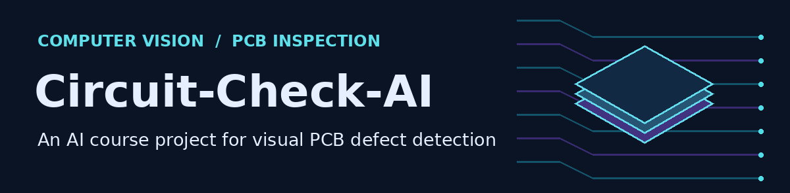
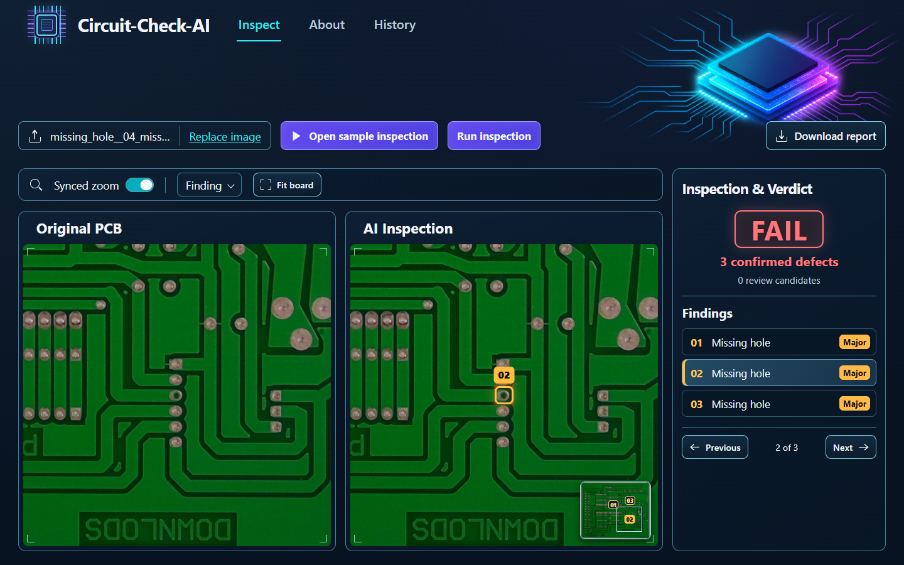
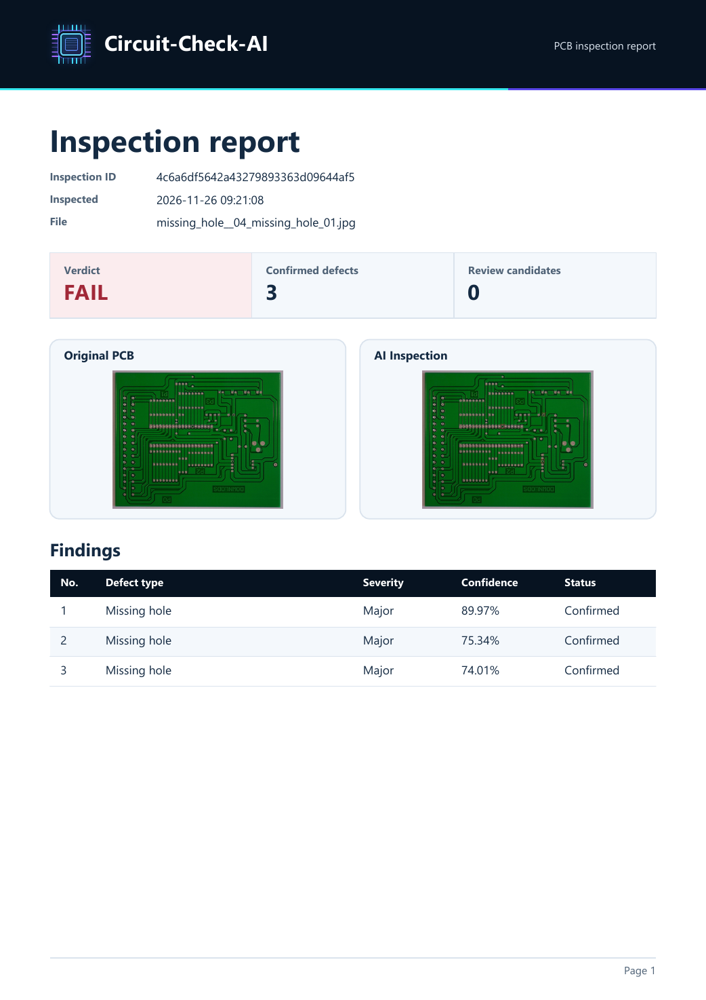
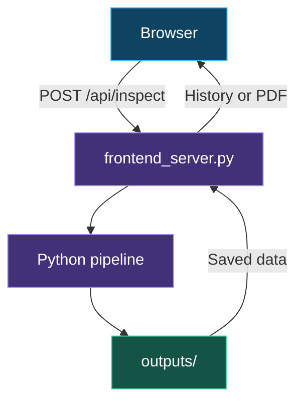
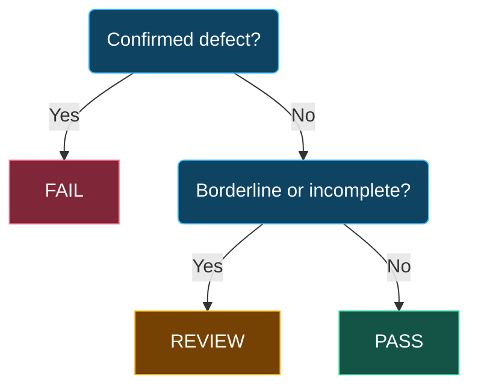

# Circuit-Check-AI



Circuit-Check-AI uses YOLO to locate visible defects in photos of bare printed circuit boards (PCBs). Compare the original and annotated board, zoom to individual findings, and download a PDF inspection report. Completed live runs are saved locally and can be reopened from History.

[Screenshots](#interface) · [PDF report](#pdf-report) · [Windows setup](#quick-start-on-windows) · [Trained model](#download-the-trained-model)

## Interface

Inspect and History show the same held-out PCB photo processed by the running app.

### Inspect

[](docs/media/inspect.png)

Select a numbered finding or use **Previous** and **Next** to zoom to its location. **Fit board** restores the full view. Synced zoom moves both views together when the matching original is available.

### About

[](docs/media/about.png)

### History

[](docs/media/history.png)

Search by filename or filter by verdict. **Open inspection** restores the selected record and its matching images, including after refreshing the browser.

## PDF report

Use **Download report** on either Inspect or History. The PDF includes the inspection ID, date, filename, verdict, both PCB views where available, and a numbered findings table with severity, confidence, and confirmed or review status. The example shows the PDF exported from the inspection above.

[](docs/media/pdf-report.png)

## Quick start on Windows

With Git and Python installed, run these commands in PowerShell. For an existing checkout, start with `Set-Location` and use the path to your copy.

```powershell
git clone --depth 1 https://github.com/AhmadElkady/Circuit-Check-AI.git
Set-Location Circuit-Check-AI
python -m venv .venv
.\.venv\Scripts\python.exe -m pip install -r requirements-data.txt
.\.venv\Scripts\python.exe -m uvicorn frontend_server:app --host 127.0.0.1 --port 8770
```

Open [Circuit-Check-AI at 127.0.0.1:8770](http://127.0.0.1:8770/) and keep the terminal running. If you use a non-cone sparse checkout, include the application files and saved outputs before starting the server.

```powershell
git sparse-checkout add /frontend_server.py /frontend/ /src/ /outputs/ /requirements-data.txt
```

### Saved samples

**Open sample inspection**, **History**, and **Download report** work without model weights when the local web app is running. The repository includes five [saved reports](outputs/reports/) with matching [annotated images](outputs/annotated/). The default archived [FAIL sample](outputs/reports/board_A_20261125_220215_796447.json) has two confirmed spurious copper defects and one spur candidate for review. Inspect keeps the **Original PCB** panel visible with an unavailable message for these archives. Their PDFs label the missing original.

## Download the trained model

Cloning gives you the app, the prepared dataset, and saved examples. A PCB-trained `best.pt` enables live inspection. Obtain the checkpoint from the team or train it using the steps below. Public release of the verified checkpoint is pending confirmation of redistribution terms.

If you have `best.pt` in your Windows Downloads folder, run this from the repository root in PowerShell.

```powershell
New-Item -ItemType Directory -Force -Path '.\models\yolo\weights' | Out-Null
Copy-Item -LiteralPath (Join-Path $env:USERPROFILE 'Downloads\best.pt') -Destination '.\models\yolo\weights\best.pt'
```

The destination is `models/yolo/weights/best.pt`. Start the app with the [Windows launch command](#quick-start-on-windows) or return to the running app. On **Inspect**, choose a JPG, JPEG, or PNG up to 20 MiB and click **Run inspection**. To repeat the example shown above, use the [held-out PCB photo](datasets/pcb/images/test/missing_hole__04_missing_hole_01.jpg).

The verified checkpoint is a fine-tuned YOLOv8n model for six PCB defect classes. It scored **62.7% mAP50**, **27.1% mAP50–95**, and **56.7% recall** on 120 held-out images. The test split contains labeled defects from one board design, so it cannot estimate the false-fail rate on clean boards.

Each successful run saves `original.png`, `annotated.png`, and `report.json` under `outputs/inspections/<inspection-id>/`. History lists these records alongside the bundled archives. Both the model and live inspection records are Git-ignored.

## Inspection flow


The model looks for **missing holes, mouse bites, open circuits, shorts, spurs, and spurious copper**. Its training scope is visible defects on bare boards.

## Architecture



The server reuses the inference, box filtering, decision, and reporting modules. For History and PDF export, it reads the selected record's JSON and images from disk.

## Verdict rules



A confirmed defect takes priority. With no confirmed defect, the decision function returns REVIEW for a borderline finding or an incomplete inspection. Otherwise it returns PASS. API errors can stop an inspection before it produces a verdict.

## Repository guide

| Path | Purpose |
| --- | --- |
| [frontend/](frontend/) | Inspect, About, and History in HTML, CSS, and JavaScript |
| [frontend_server.py](frontend_server.py) | Local web server, upload API, History catalog, and PDF download |
| [src/](src/) | Inference, post-processing, verdicts, reporting, and training |
| [src/pdf_report.py](src/pdf_report.py) | Shared PDF layout for Inspect and History |
| [outputs/](outputs/) | Bundled sample reports and annotations, training artifacts, and local inspection records |
| [main.py](main.py) | Legacy Streamlit demo with its own `streamlit` dependency |
| [scripts/](scripts/) and [datasets/pcb/](datasets/pcb/) | Dataset preparation and the grouped YOLO split |
| [tests/](tests/) | Run with `.\.venv\Scripts\python.exe -m pytest -q`. Model weights are optional for these tests. |

## Train and evaluate

The [PCB Defects dataset](https://www.kaggle.com/datasets/akhatova/pcb-defects) is converted from Pascal VOC annotations to YOLO labels and split by board group. The prepared split contains 393 training, 180 validation, and 120 test images. The [dataset publisher limits use to academic research](https://robotics.pkusz.edu.cn/resources/registerENG/).

In a sparse checkout, include `/datasets/pcb/` before training. Set the `path` in [data.yaml](datasets/pcb/data.yaml) to your local dataset root, then run [the training script](src/train.py) from the repository root.

```powershell
.\.venv\Scripts\python.exe src/train.py
```

The script fine-tunes YOLOv8n and copies its validation-selected checkpoint to `models/yolo/weights/best.pt`.
